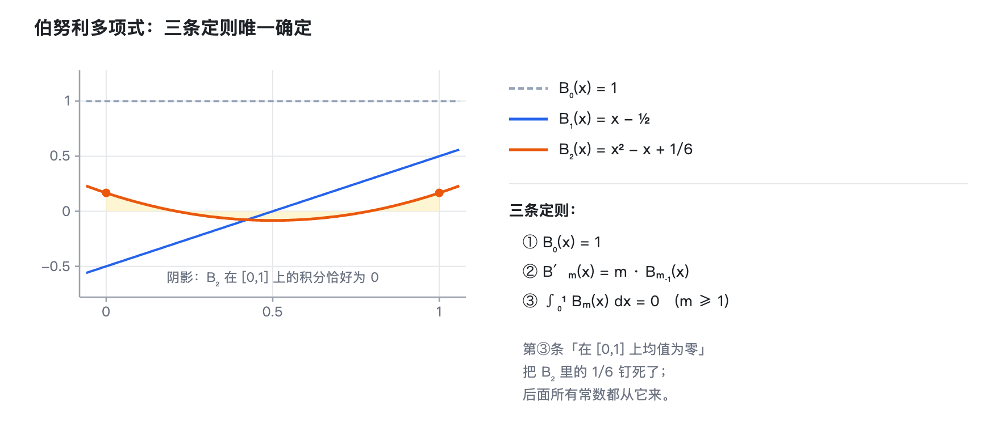
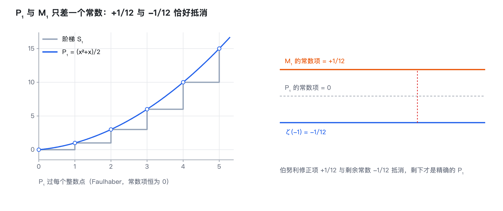
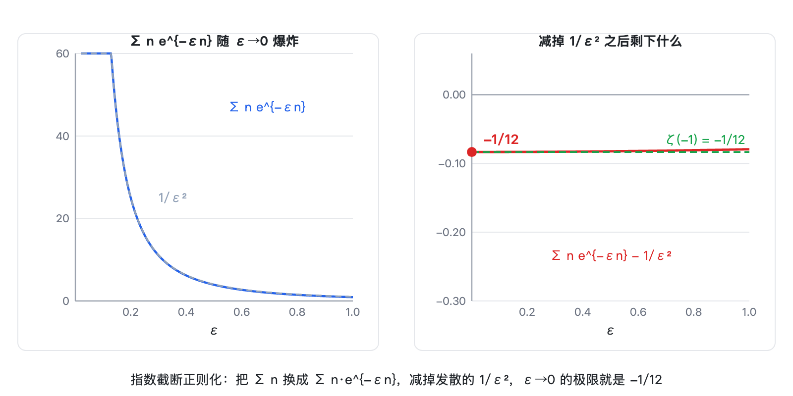

# 如何理解“全体自然数之和等于 -1/12”？

$$
1+2+3+4+\cdots=-\frac{1}{12}
$$

这个式子看起来荒谬：左边越加越大，右边却是个负数。

**在普通意义下，它当然是错的**——左边的部分和趋向 $+\infty$，根本不存在普通的和。

但它也不是营销号编出来的。它出现在 Ramanujan 1913 年写给 Hardy 的信里，出现在卡西米尔效应的实验数据里，出现在玻色弦论推出临界维数 $D=26$ 的那一步代数里；它也正是黎曼 $\zeta$ 函数在 $s=-1$ 处的取值。

所以真正该问的是：**这个等号到底在说什么？**

有一个流传很广的说法是：

> $-1/12$ 是阶梯函数 $f(x)=1+2+3+\cdots+\lfloor x\rfloor$ 用光滑多项式拟合出来的常数部分。

这句话对不对？顺着它往下追问，会逼出三个具体问题：

1. 那条光滑多项式长什么样？
2. 拟合规则是什么？
3. 有没有一种方法，对 $f(x,n)=1^n+2^n+\cdots+\lfloor x\rfloor^n$ 的每个 $n$ 都成立？

三个问题都有干净的答案，而答案会拆成两半：

- **拟合有限和的那条多项式，常数项恒为 $0$**；
- $-1/12$ 是另一条规则——**欧拉–麦克劳林分解**——里被单独摘出来的剩余常数。

下面分开讲。

<!-- truncate -->

## 一、拟合有限和：Faulhaber 多项式

先把问题写清楚。令 $N=\lfloor x\rfloor$，定义

$$
f(x,n)=\sum_{k=1}^{\lfloor x\rfloor}k^{n}.
$$

$f$ 是一条阶梯：在 $[N,N+1)$ 上它取常数 $S_n(N)=\sum_{k=1}^{N}k^{n}$，每跨过一个整数往上跳一级，跳的高度是 $N^n$。

“用光滑多项式拟合”最自然的读法是：**在每个整数点上都对得上**。也就是要求一条多项式 $P_n$ 满足

$$
P_n(N)-P_n(N-1)=N^{n},\qquad P_n(0)=0.
$$

第一条说“从 $N-1$ 走到 $N$ 恰好增加 $N^n$”，第二条说“从空和出发”。 $n+2$ 个条件钉死一个 $n+1$ 次多项式，解唯一——这就是 **Faulhaber 求和公式**：

$$
\boxed{\,P_n(x)=\frac{B_{n+1}(x+1)-B_{n+1}(1)}{n+1}\,}
$$

其中 $B_m(x)$ 是第 $m$ 个伯努利多项式。这个式子对每个非负整数 $n$ 都成立。前几个：

| $n$ | $P_n(x)$ |
|---|---|
| $0$ | $x$ |
| $1$ | $\dfrac{x^2}{2}+\dfrac{x}{2}$ |
| $2$ | $\dfrac{x^3}{3}+\dfrac{x^2}{2}+\dfrac{x}{6}$ |
| $3$ | $\dfrac{x^4}{4}+\dfrac{x^3}{2}+\dfrac{x^2}{4}$ |
| $4$ | $\dfrac{x^5}{5}+\dfrac{x^4}{2}+\dfrac{x^3}{3}-\dfrac{x}{30}$ |
| $5$ | $\dfrac{x^6}{6}+\dfrac{x^5}{2}+\dfrac{5x^4}{12}-\dfrac{x^2}{12}$ |

现在盯住常数项：**全都是 $0$**。这不是巧合 —— $x=0$ 时分子里 $B_{n+1}(1)-B_{n+1}(1)=0$，而我们本来就从空和出发。

所以，“过每个整数点”这条规则给出的答案是 $P_1(x)=\dfrac{x^2}{2}+\dfrac{x}{2}$，常数项 $0$，和 $-1/12$ 没有关系。

伯努利多项式本身由三条定则唯一确定，不需要生成函数：

$$
B_0(x)=1,\qquad B_m'(x)=mB_{m-1}(x),\qquad \int_0^1B_m(x)\,dx=0\ (m\ge1).
$$

第三条“在 $[0,1]$ 上均值为零”把 $B_2(x)=x^{2}-x+\dfrac{1}{6}$ 里的 $\dfrac{1}{6}$ 钉死了——后面所有常数都从它来。

## 二、换一条规则：欧拉–麦克劳林

要拿到 $-1/12$，得换规则：不再要求逐点相等，而是把有限和**拆成几块**，再把其中一块单独取出来。

对非负整数 $n$，

$$
S_n(N)=\frac{N^{n+1}}{n+1}+\frac{N^{n}}{2}+\sum_{r=1}^{\lfloor(n+1)/2\rfloor}\frac{B_{2r}}{(2r)!}\cdot\frac{n!}{(n-2r+1)!}\,N^{\,n-2r+1}+\zeta(-n).
$$

右边四块依次是：**积分项**、**端点项**、**伯努利修正项**，以及一个**剩余常数** $\zeta(-n)$。

把不含 $\zeta(-n)$ 的那部分记作 $M_n(N)$，称它为**欧拉–麦克劳林多项式**。上式就写成

$$
S_n(N)=M_n(N)+\zeta(-n).
$$

关键在于： $S_n(N)$ 在整数点上恰好等于 $P_n(N)$，也就是第一节那条精确多项式。于是

$$
\boxed{\,M_n(N)=P_n(N)-\zeta(-n)\,}
$$

**两条多项式只差一个常数。** 而 $P_n$ 的常数项是 $0$，所以 $M_n$ 的常数项必然是 $-\zeta(-n)$。

整个结构到这里就清楚了： $-1/12$ 既不是 $P_n$ 的常数项（那是 $0$），也不是 $M_n$ 的常数项（那是 $-\zeta(-n)$， $n=1$ 时为 $+1/12$）。它是两条多项式之差 $P_n-M_n=\zeta(-n)$ —— 一个「差」，而不是任何一条曲线自己的截距。

## 三、n=1 时，+1/12 与 −1/12 恰好抵消

把 $n=1$ 代进欧拉–麦克劳林公式。因为 $B_2=\dfrac{1}{6}$，求和只剩 $r=1$ 一项：

$$
1+2+\cdots+N=\frac{N^{2}}{2}+\frac{N}{2}+\frac{1}{12}+\zeta(-1).
$$

而左边的精确求和多项式我们早就知道：

$$
1+2+\cdots+N=\frac{N^{2}}{2}+\frac{N}{2}.
$$

两式相减，多项式部分一模一样，只剩下常数：

$$
\frac{1}{12}+\zeta(-1)=0.
$$

所以

$$
\boxed{\,\zeta(-1)=-\frac{1}{12}\,}
$$

请留意这里发生了什么 —— $+\dfrac{1}{12}$ 和 $-\dfrac{1}{12}$ **精确抵消了**。 $-1/12$ 既不属于 $\dfrac{N^2}{2}+\dfrac{N}{2}$ 的常数项（那一项是 $0$），也不属于 $M_1$ 的常数项（那一项是 $+\dfrac{1}{12}$）——它是**被单独摘出来的剩余常数**。

## 四、这套做法对每个 n 都成立

同一个公式给出统一表达式。采用 $B_1=-\dfrac{1}{2}$ 的约定，

$$
\boxed{\,\zeta(-n)=\frac{(-1)^{n}B_{n+1}}{n+1}\,}
$$

它对每个非负整数 $n$ 都成立。于是 $M_n$ 的常数项 $-\zeta(-n)$ 也有了通式：

| $n$ | $M_n(N)$ 的常数项 | $\zeta(-n)$ | 幂次 |
|---|---|---|---|
| $0$ | $+\dfrac{1}{2}$ | $-\dfrac{1}{2}$ | 偶 |
| $1$ | $+\dfrac{1}{12}$ | $-\dfrac{1}{12}$ | 奇 |
| $2$ | $0$ | $0$ | 偶 |
| $3$ | $-\dfrac{1}{120}$ | $+\dfrac{1}{120}$ | 奇 |
| $4$ | $0$ | $0$ | 偶 |
| $5$ | $+\dfrac{1}{252}$ | $-\dfrac{1}{252}$ | 奇 |

两列永远互为相反数——这正是 $M_n=P_n-\zeta(-n)$ 配上 $P_n(0)=0$ 的直接后果。

**奇偶分工很清楚：**

- **n 为偶数时**：当 $n\ge2$， $B_{n+1}$ 的下标是大于 $1$ 的奇数，而这样的伯努利数等于 $0$，于是 $\zeta(-n)=0$， $M_n$ 的常数项也是 $0$，没有东西需要抵消。
- **n 为奇数时**：伯努利修正项的最后一项，也就是 $r=\dfrac{n+1}{2}$ 那一项，给出 $N^{0}$，是一个真正的常数，数值恰好是 $-\zeta(-n)$——它和公式末尾那个 $+\zeta(-n)$ **精确抵消**。

所以“奇数次幂时会出现一个很有规律的常数抵消”不是巧合，它是 $\zeta(-n)=\dfrac{(-1)^{n}B_{n+1}}{n+1}$ 与“奇下标伯努利数为零”这两条事实的直接投影。

## 五、能不能说 −1/12 是“光滑多项式的常数部分”？

可以，但必须补一个限定：**说清楚是哪条规则。**

- **规则一，逐点相等**：得到 Faulhaber 多项式 $P_n$，常数项 $0$。
- **规则二，欧拉–麦克劳林分解**：得到欧拉–麦克劳林多项式 $M_n$，常数项 $-\zeta(-n)$；把剩余常数 $\zeta(-n)$ 单拎出来， $n=1$ 时就是 $-1/12$。

而“光滑拟合”这四个字本身并不指定规则。同一个函数、同一个多项式空间，换一个目标（按区间面积平均、按最小二乘、按差分结构……）就会换一个常数。**所以“用多项式拟合一下”这句话本身不构成任何论证。**

$-1/12$ 是**指定规则下的产物**：指定欧拉–麦克劳林，等价地指定解析延拓。规则一旦定下来，它就被唯一确定了。

## 六、为什么那些“初等推导”都不可信

因为级数不收敛，“求和”必须先指定规则；而任何规则都躲不过下面这一条：

> 一个求和法若同时满足**线性**与**稳定性**（删掉前有限项不改变和），又给 $1+2+3+\cdots$ 一个有限值，就会推出 $0=1$。

证明只要一行。设 $S$ 是 $1+2+3+4+\cdots$ 的值。稳定性说 $2+3+4+\cdots$ 的值也是 $S$；线性说 $1+(2+3+4+\cdots)$ 的值是 $1+S$。可左边就是原级数本身，值仍是 $S$。于是 $S=S+1$。

所以求和法必须放弃线性或稳定性之一。Cesàro、Abel 那一套能处理振荡发散（Grandi 级数 $1-1+1-\cdots=\frac{1}{2}$），但对趋向 $+\infty$ 的级数无能为力。网上流传的“巧拼”全都悄悄借了某条规则，又不说明用的是哪条。

## 七、两个独立验证

**其一，解析延拓。** $\zeta(s)=\sum n^{-s}$ 只在 $\mathrm{Re}(s)>1$ 收敛，但它有唯一的解析延拓到 $\mathbb{C}\setminus\{1\}$，函数方程是

$$
\zeta(s)=2^{s}\pi^{s-1}\sin\frac{\pi s}{2}\,\Gamma(1-s)\,\zeta(1-s).
$$

代入 $s=-1$ 得 $\zeta(-1)=-\dfrac{1}{12}$。这是纯复分析，和有限求和毫无关系，却给出同一个数。

**其二，截断正则化。** 把发散的和换成收敛的：

$$
\sum_{n\ge1}n\,e^{-\varepsilon n}=\frac{1}{\varepsilon^{2}}-\frac{1}{12}+\frac{\varepsilon^{2}}{240}-\cdots
$$

$\varepsilon\to0$ 时 $\dfrac{1}{\varepsilon^2}$ 炸掉，剩下的有限部分正是 $-\dfrac{1}{12}$（实测 $\varepsilon=0.002$ 时余项为 $-0.0833333167$）。

而且这个常数不依赖截断的具体形状：换成高斯截断 $\sum n\,e^{-\varepsilon n^{2}}$，有限部分仍然趋于 $-\dfrac{1}{12}$，只是发散项变成 $\dfrac{1}{2\varepsilon}$。原因还是欧拉–麦克劳林——端点修正 $-\dfrac{B_2}{2!}f'(0)$ 里的 $f'(0)$ 对任何归一化的截断都等于 $1$。

## 八、物理里两处现身

**卡西米尔效应。** 两块平行导体板之间电磁模式的零点能求和给出 $\dfrac{\hbar c\pi}{2a}\cdot\left(-\dfrac{1}{12}\right)=-\dfrac{\pi\hbar c}{24a}$，负号意味着吸引力。1997 年 Lamoreaux 的实验测到了这个力，误差约 5%。

**玻色弦的临界维数。** 弦的振子零点能是 $-\dfrac{D-2}{24}$，其中 $D$ 是时空维数。要让这无穷多个振子的总能量不破坏洛伦兹协变性，唯一的出路是 $D=26$；换成超弦则是 $D=10$。

这两处都不是比喻——同一个常数真的出现在可观测量里。

## 收尾

回到开头那三个问题：

1. **多项式是什么？** 逐点拟合给 $P_1(x)=\dfrac{x^2+x}{2}$；欧拉–麦克劳林分解给 $M_1(x)=\dfrac{x^2+x}{2}+\dfrac{1}{12}$。
2. **规则是什么？** 前者是“每个整数点都相等”，后者是“积分项 + 端点项 + 伯努利修正 + 剩余常数”。
3. **对每个 n 都成立吗？** 成立，统一公式 $\zeta(-n)=\dfrac{(-1)^{n}B_{n+1}}{n+1}$ 一个式子管全部。

所以 $1+2+3+\cdots=-\dfrac{1}{12}$ 这句话，等号承载的不是“相等”，而是**一整套约定的选择**：选定欧拉–麦克劳林（等价地，伯努利那套归一化），再把发散部分与剩余常数分开。分开之后，剩下那个常数就是 $-\dfrac{1}{12}$。

而物理学家敢把它写进论文，是因为三条互相独立的路径——欧拉–麦克劳林的剩余常数、解析延拓、截断正则化——递给他们同一个数。（Faulhaber 多项式本身给的是 $0$，它的作用是把多项式部分钉死，让剩下那个常数无处可藏。）那不是巧合，那是同一件事的三种说法。

---

**参考**

- Wikipedia, *1 + 2 + 3 + 4 + ⋯*（Ramanujan 求和、发散级数的稳定性反例）
- Wikipedia, *Faulhaber's formula* / *Bernoulli polynomials* / *Euler–Maclaurin formula*
- DLMF §2.10 *Sums and Sequences*；§25.6 *Integer Arguments*
- Wikipedia, *Casimir effect*（Lamoreaux, 1997）；*Bosonic string theory*（临界维数 26）
- 文中全部数值结论（Faulhaber 多项式系数、 $\zeta(-n)$ 的取值、截断余项、奇数次幂的常数抵消）均用 mpmath 逐项复算核对
